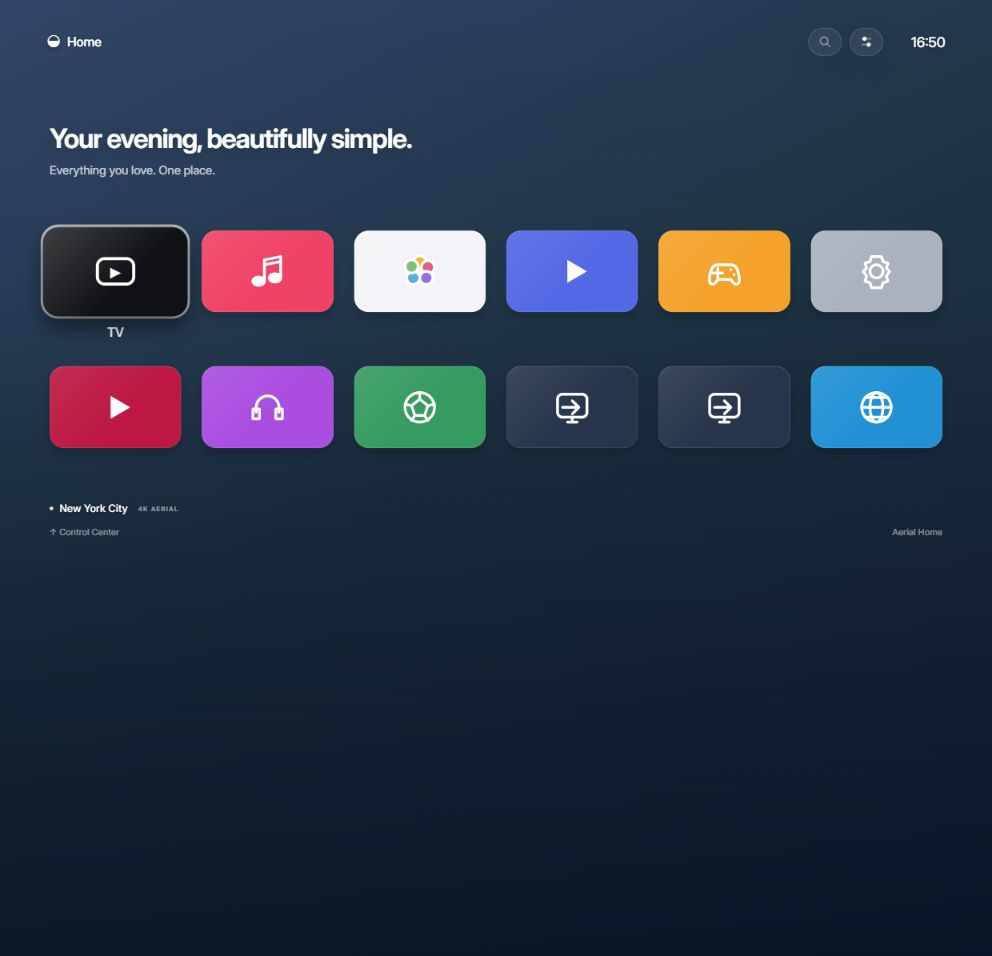
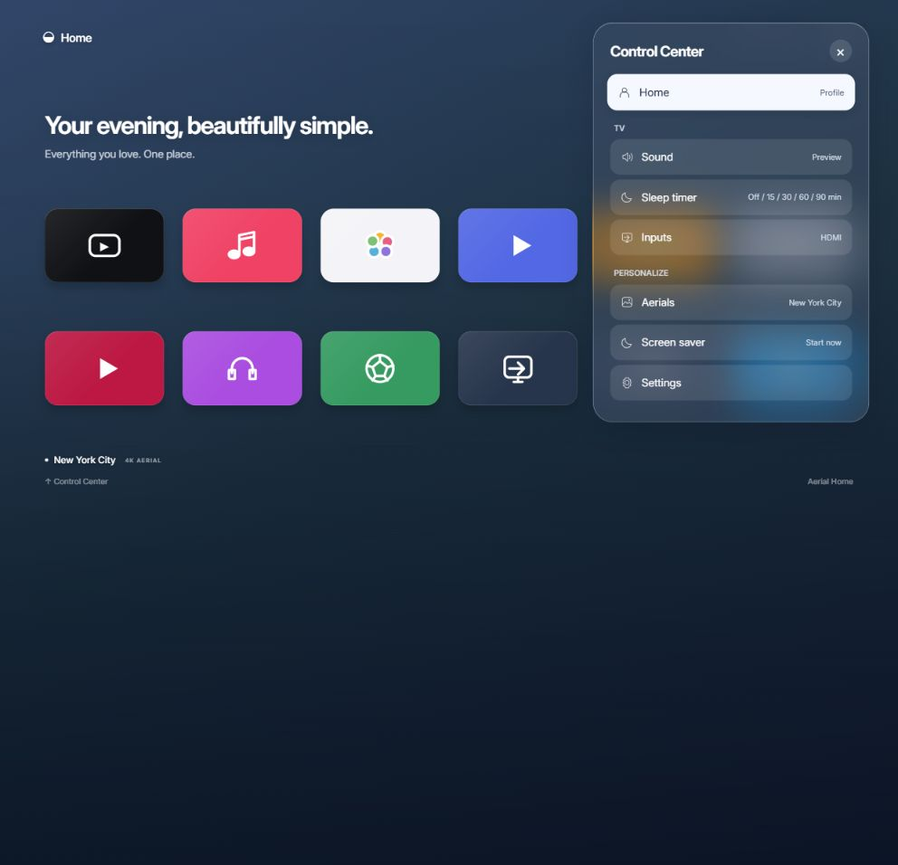

# Aerial Home for webOS

An independent, open-source home screen for LG TVs, inspired by the spacing, focus behavior and translucent controls of tvOS 26. Built from scratch in HTML, CSS and JavaScript. MIT licensed.

**Early alpha.** This is a working launcher, not a complete tvOS implementation or a pixel-identical replica. It launches LG apps and inputs. It cannot install tvOS apps or reproduce Apple's private services.





## Included

- Installed LG app discovery and local app artwork, including higher resolution icons where available.
- HDMI inputs discovered from the TV rather than hard-coded labels.
- Six-column standard grid or five-column large grid, keyboard/remote navigation and animated focus.
- Reorder and hide apps, create/edit folders, search installed apps.
- Translucent Control Center, TV volume/mute, native sleep timer, input selection.
- Dark, light and time-based appearance, reduced motion and a local profile name.
- Three Apple-hosted city aerials with verified 3840×2160 HEVC SDR source files; idle screen saver.
- Bounded service timeouts, validated artwork paths, no telemetry, no cloud account and no Pi runtime dependency.

Apple Account, Siri, FaceTime, HomeKit, AirPlay routing, Apple Music Sing and tvOS App Store apps are not implemented. A profile name does not switch streaming-service accounts. Search searches installed apps, not streaming catalogues. There is no fabricated Top Shelf/watch history integration. See [scope and validation](docs/status.md).

## Preview and build

Requires Node.js 22 or newer. There are no package dependencies or installation steps.

```sh
node tools/serve.cjs
# Open http://127.0.0.1:5178

node --test test/*.test.cjs
node tools/package.cjs
```

The package and SHA-256 checksum are written to `dist/`. The reproducible packager produces a standard IPK with no installation scripts. CI also builds an artifact.

The desktop preview uses original sample tiles and a gradient backdrop. The included HEVC MOV aerials require a compatible hardware decoder; the preview does not claim desktop playback support.

## Install on a TV

The current adapter targets a **rooted webOS TV with Homebrew Channel** installed. Development tested on an LG B4 running webOS 9.2.4. Ordinary Developer Mode alone does not grant the app inventory/artwork access used here. Rooting and firmware compatibility are outside this app's installer.

1. Download the IPK from Releases, or build it yourself.
2. Install it with webOS Dev Manager / the LG CLI, or use Homebrew Channel's verified package installer. See [installation](docs/install.md).
3. Open **Aerial Home** from the TV's app list.

The app ID is `io.github.justmaaarco.aerialhome`. Installation adds a separate app. It does not replace LG Home, modify startup scripts, map remote Power/Home buttons or uninstall another launcher.

## Remote

| Action | Control |
| --- | --- |
| Navigate | Direction arrows; Magic Remote pointer also works |
| Open app | OK |
| App actions / move / hide | Hold OK, or right-click in the browser |
| Control Center | Up from the first app row; red key; or top-right button |
| Close panel | Back |
| Move app | Hold OK → Move → arrows → OK; Back cancels |
| Search | Top-right search button; `S` on a keyboard |
| Dismiss screen saver | Any remote direction/OK, or pointer movement |

## Media and attribution

App artwork is read from the user's installed apps and stays on the TV. It is not included in this repository. Demo icons and launcher icon are original artwork. Inter is bundled under the SIL Open Font License; see [its license](app/assets/Inter-LICENSE.txt).

Aerial videos are **not bundled or covered by this project's MIT license**. The app references public Apple media endpoints. These currently use HTTP; no credentials are sent. Availability and permission to use the media are separate from this project's code license. We do not disable TLS validation or imply an Apple media redistribution license.

This project is not affiliated with or endorsed by Apple or LG. Apple TV, tvOS and Liquid Glass are Apple's names. The rendering is an independent CSS approximation, not Apple's Liquid Glass implementation. LG documents a 1080p graphics plane and up to 4K video playback for UHD TVs: [app resolution](https://webostv.developer.lge.com/develop/specifications/app-resolution).

## Contributing

Keep shell operations restricted to the explicit adapter commands and validated local application asset paths. Do not add general command execution, tokens, TV addresses, personal app inventories or private screenshots to the repository. Hardware behavior must be reported separately from browser tests. Visual parity needs reference screenshots and measured comparison before it can be claimed.
