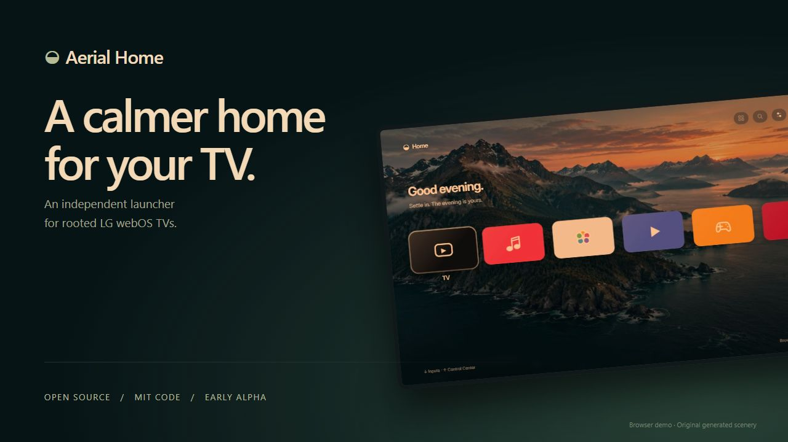
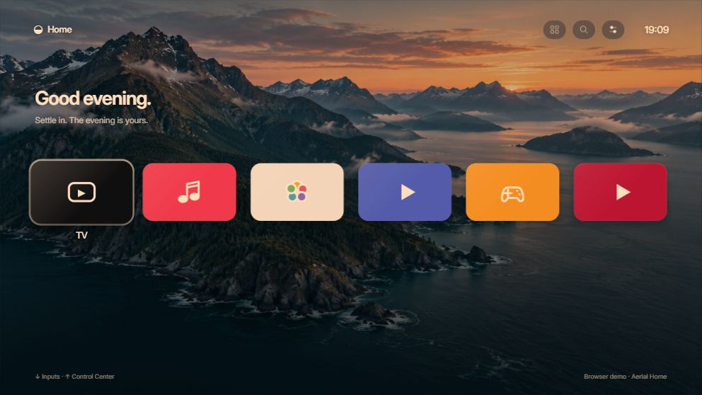
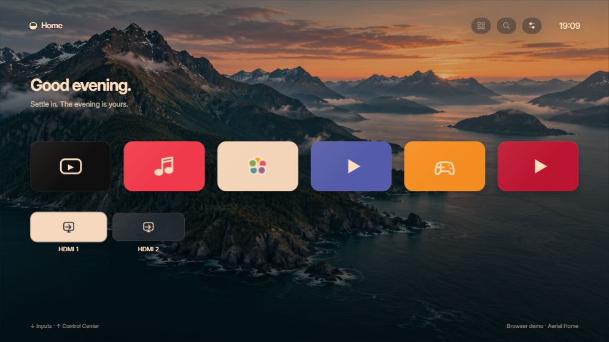
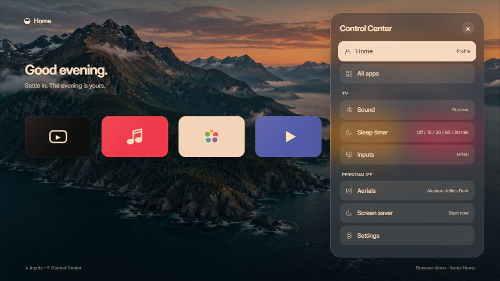
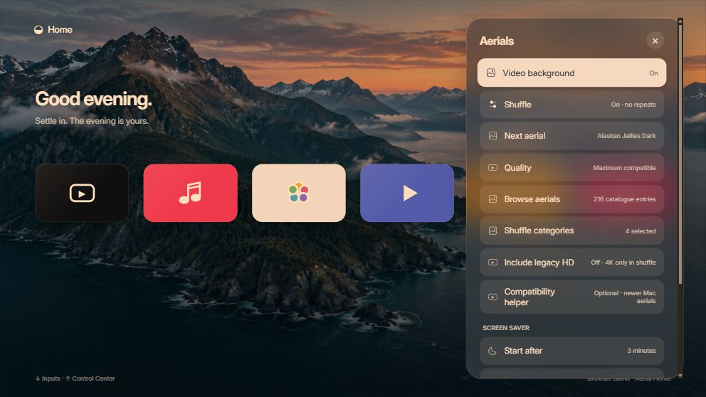
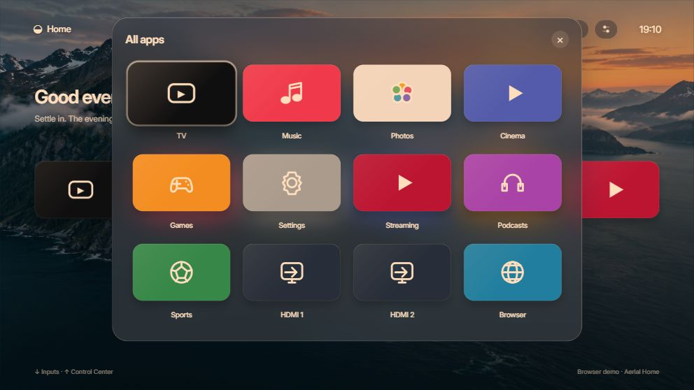
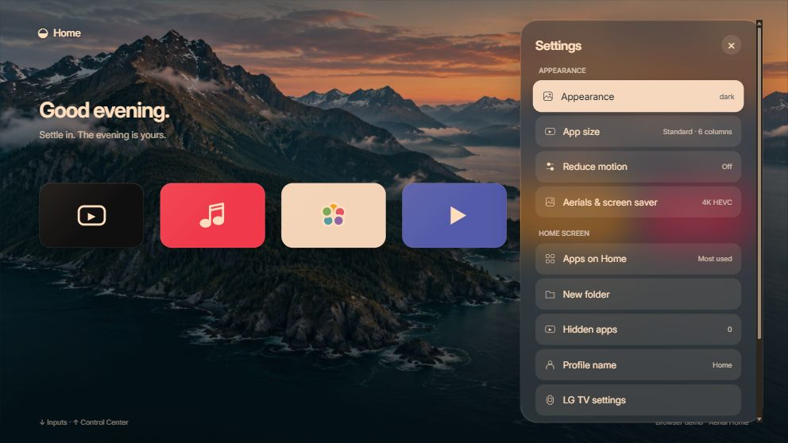

# Screenshot gallery

Actual Aerial Home 0.2.2 browser-preview captures, with original sample icons and an original AI-generated scenic still. No TV addresses, account names, installed-app artwork or Apple video frames are included. The still image demonstrates the layout; it does not demonstrate HDR or video playback.

| Home | Inputs |
| --- | --- |
|  |  |

| Control Center | Aerial controls |
| --- | --- |
|  |  |

| App library | Personalization |
| --- | --- |
|  |  |

The six UI captures are 992×558 JPEGs from the app's scaled 16:9 stage. The sharing card is a 1280×720 browser-rendered composition using the Home capture. Files retain the native browser screenshot format; no UI was redrawn by an image generator. The [standalone HTML gallery](index.html) also works locally with these images in the same folder.

## Reproduce

Run `node tools/showcase.cjs`, open the printed local address, and capture the 16:9 stage. Navigate using the real controls: Home; Down for inputs; Control Center; Aerials; All apps; Settings. The showcase serves the unchanged app with an extra demo-only stylesheet. It binds to loopback and makes no TV connection. A fresh browser profile/origin avoids existing preview preferences. Before publishing, inspect names and every visible field; do not capture the Compatibility helper address form from a configured TV.

The [backdrop prompt and provenance](../showcase/README.md) are included. The demo art and screenshot gallery are outside `app/` and are not included in installable IPKs. The actual TV graphics/video planes, latency and format support are described separately in [validation](../status.md).
